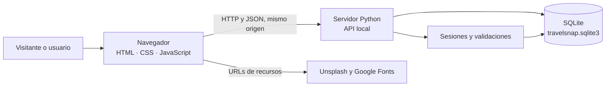
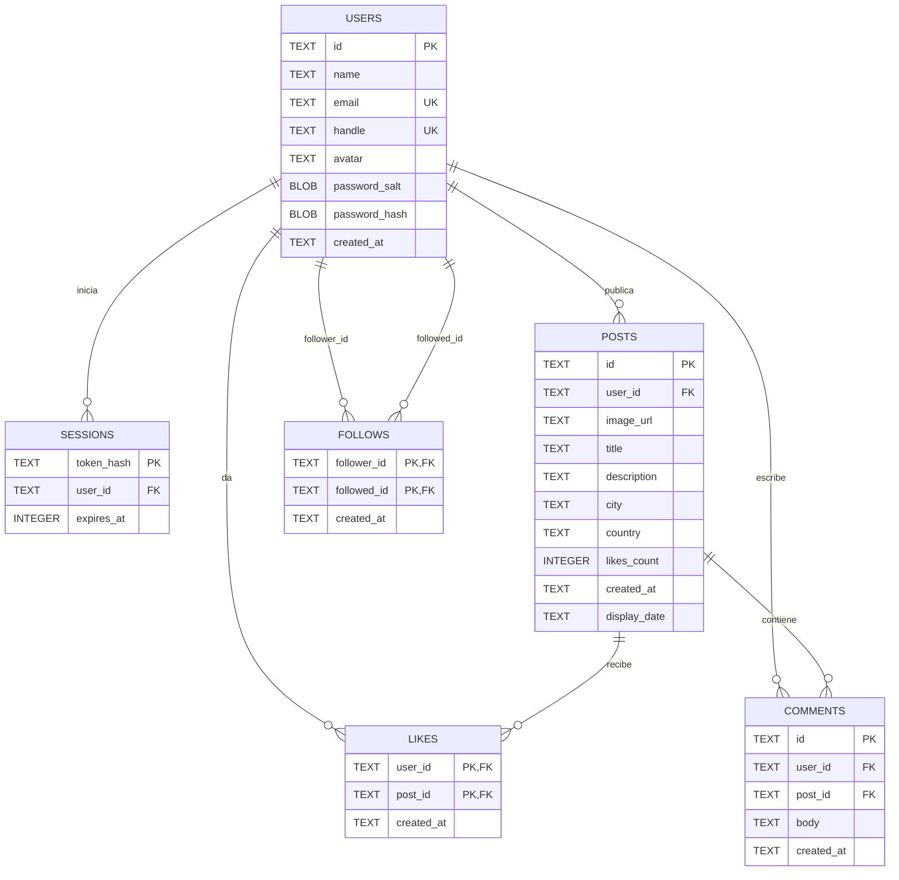
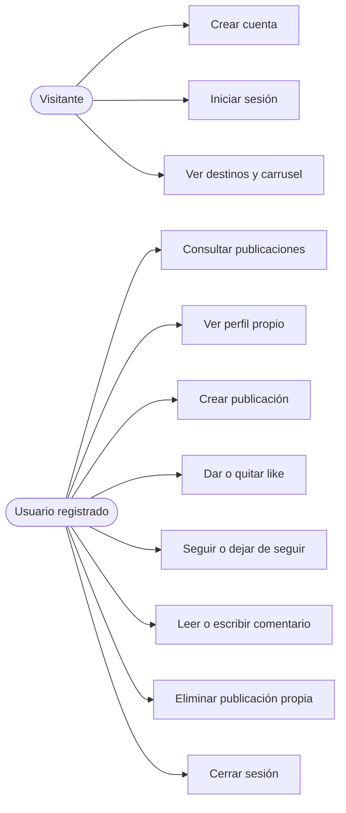
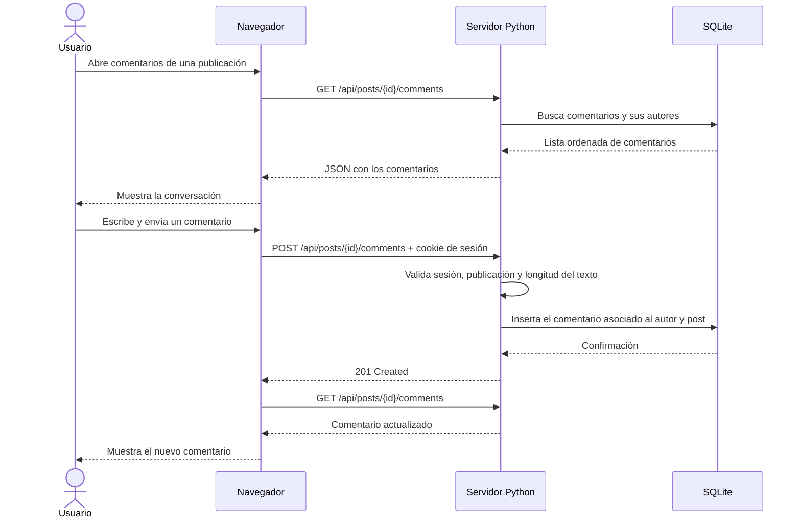

# Diagramas de TravelSnap

Estos diagramas describen el estado actual del prototipo. El esquema entidad-relación editable también está en [formato draw.io](diagrams/TravelSnap_ER.drawio).

Versiones editables: [arquitectura](diagrams/TravelSnap_Architecture.drawio), [casos de uso](diagrams/TravelSnap_UseCases.drawio) y [secuencia de comentarios](diagrams/TravelSnap_CommentsSequence.drawio).

## 1. Arquitectura actual

## 2. Entidad-relación

## 3. Casos de uso principales

## 4. Secuencia: comentar una publicación

