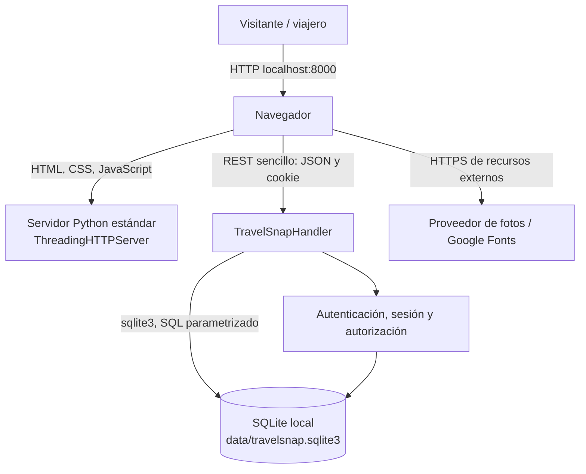
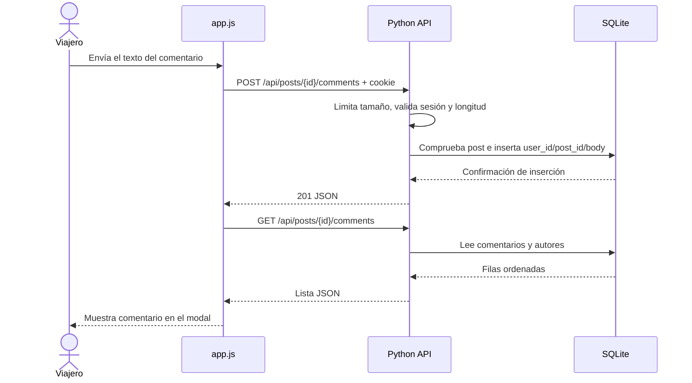

# Arquitectura de TravelSnap (prototipo local)

## Vista de despliegue



El navegador solicita las páginas estáticas y consume la API desde el mismo origen. Esto evita configurar CORS en la demostración. Python recibe solicitudes HTTP, valida los cuerpos, identifica la cuenta desde la cookie de sesión y ejecuta SQL parametrizado sobre SQLite. La base se crea al arrancar usando `database.sql`. No existe un servicio de base remoto ni una capa de almacenamiento de fotos: `posts.image_url` conserva enlaces HTTPS.

## Responsabilidades y flujo

1. **Presentación (`index.html`, `styles.css`, `app.js`):** portada, navegación, formularios, feed y modales. `app.js` llama la API con JSON y renderiza las respuestas.
2. **API (`server.py`):** servidor HTTP, rutas, validación, hashing de claves, emisión/validación de sesiones y controles de propiedad. La API no debe aceptar del navegador un `user_id` como autoridad: usa la sesión.
3. **Persistencia (`database.sql`, `data/travelsnap.sqlite3`):** cuentas, sesiones, publicaciones, comentarios, likes y seguimientos. `data/` es generado localmente y excluido por `.gitignore`.
4. **Recursos externos:** fotografías de ejemplo y tipografías. Su disponibilidad depende de terceros; la aplicación no controla su retención ni disponibilidad.

## Solicitud de ejemplo: crear comentario



## Persistencia y reglas

| Tabla | Propósito | Reglas destacadas |
|---|---|---|
| `users` | Cuenta, datos visibles y credenciales | ID PK; email/handle únicos sin distinguir mayúsculas; hash y sal no se devuelven por API. |
| `sessions` | Sesiones activas | Token aleatorio no reversible guardado como SHA-256; usuario FK; vencimiento. |
| `posts` | Historias y destino | Autor FK; URL/título/descripción/ciudad/país requeridos; contador no negativo. |
| `comments` | Conversación | Autor y publicación FK; cuerpo de 1–1000 caracteres. |
| `likes` | Relación de like | PK compuesta (usuario, post) impide duplicados. |
| `follows` | Relación seguidor/seguido | PK compuesta; CHECK prohíbe auto-seguimiento. |

Todas las relaciones usan claves foráneas con eliminación en cascada donde corresponde. `connect_db()` activa `PRAGMA foreign_keys=ON` por conexión. Los contadores de likes se mantienen al insertar o borrar la relación.

## Sesión y seguridad actual

- El servidor genera un token criptográficamente aleatorio, persiste su SHA-256 y envía el token en cookie `HttpOnly`, `SameSite=Strict`, `Path=/` con vencimiento de 14 días.
- El hash de contraseñas usa PBKDF2-HMAC-SHA256, sal individual aleatoria de 16 bytes y 310.000 iteraciones.
- Hay límite de cuerpo JSON (64 KiB), validaciones de campos, SQL parametrizado y cabeceras `nosniff` y `Referrer-Policy`.
- Las operaciones de escritura requieren sesión; el ID de autor se toma de ella. Borrar publicación requiere que su `user_id` coincida con el usuario autenticado.
- Esta instancia es HTTP local, por eso no marca cookie `Secure`. En despliegue HTTPS se debe habilitarla, configurar un servidor frontal TLS, proteger secretos, limitar intentos y revisar CSRF/rate limiting. Este prototipo no es una configuración de producción.

## Límites y evolución recomendada

SQLite es adecuada para la demostración local. Antes de múltiples instancias o volumen alto: definir migraciones, evaluar PostgreSQL, añadir paginación con cursor e índices según consultas y respaldos probados. Antes de fotos subidas: elegir almacenamiento compatible, cuotas, validación real de formato, límites de tamaño y URLs controladas. Añadir autenticación/autorización de roles únicamente con requisitos de administración y pruebas explícitas.

## Arranque local

```powershell
python server.py
```

Abre `http://localhost:8000`. El servidor crea `data/travelsnap.sqlite3` si no existe. El motor DB no es accesible desde Google ni por una URL pública; se inspecciona localmente con un cliente SQLite.
